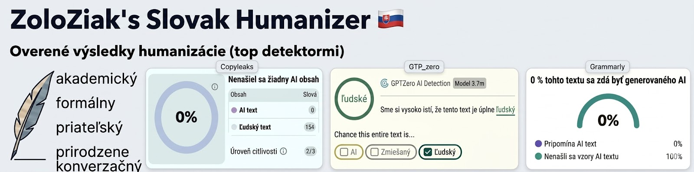

# Humanizer Slovak




Humanizer Slovak je skill pre jazykové modely. Prepíše slovenský text tak, aby neznel ako od AI. Hľadá v ňom 39 vzorov: 27 štýlových, 7 gramatických, ktoré platia len pre slovenčinu, a 5 prevzatých z anglického humanizeru.

Spravil som ho, lebo som potreboval slovenský text od AI, ktorý nesmrdí AI. Anglické nástroje slovenčinu nepokryjú. Model videl oveľa viac češtiny než slovenčiny a myslí akoby po anglicky, takže keď si nie je istý, podtečie do jedného alebo do druhého. Práve na to je sedem slovenských vzorov (28 – 34).

## Ako to funguje

Skill text prepíše, potom sa sám spýta, čo na ňom ešte prezrádza AI, a dorobí opravy. Ak nezadáš štýl, najprv sa ho opýta. Na výber sú štyri:

- akademický: odborný a presný, na výskum a odborné práce
- formálny: profesionálny, na firemnú komunikáciu a produktové texty
- priateľský: vrelý tón, na blogy, newslettre a sociálne siete
- konverzačný: neformálny, akoby si písal kamarátovi

Hľadá slovenské AI klišé („V dnešnej dobe“, „Je dôležité zdôrazniť“, „Na záver možno konštatovať“), anglický slovosled, kalky, nominalizácie, nafúknutý jazyk, trpný rod a vágne atribúcie. Nielen škrtá, snaží sa dodať aj hlas. Má tiež zoznam vecí, ktoré opravovať netreba, lebo dokonalá gramatika ešte nie je dôkaz AI, a znaky ľudského písania, ktoré má nechať na pokoji.

## Pomlčky

Najviditeľnejší prezradca AI textu je dlhý znak „—“ (em dash). Bežný Slovák ho nepíše: na klávesnici nemá vlastný kláves a v slovenskej typografii sa nepoužíva. Skill ho preto do výstupu nepustí vôbec. Dá pomlčku „–“ s medzerami, alebo vetu radšej prestaví. Spojovník pomlčku nenahrádza.

Tri znaky, ktoré sa v slovenčine nesmú zamieňať:

| Znak | Názov | Kód | Použitie |
|------|-------|-----|----------|
| - | spojovník | U+002D | zložené slová a mená bez medzier (slovensko-poľský) |
| – | pomlčka | U+2013 | vetná pomlčka a rozpätie, s medzerami (text – pokračovanie, 1980 – 1990) |
| — | em dash | U+2014 | v slovenčine sa nepíše |

## Príklad

Vstup (typický AI text):

> V dnešnej rýchlo sa meniacej digitálnej dobe je čoraz dôležitejšie venovať pozornosť oblasti umelej inteligencie. Je dôležité zdôrazniť, že AI predstavuje revolučnú technológiu, ktorá zásadným spôsobom mení krajinu moderného podnikania.

Výstup (štýl priateľský):

> AI v podnikaní riešia firmy teraz, nie o päť rokov. Ale úprimne, väčšina z nich ešte len skúša, čo to vlastne vie.

## Vzory

Číslovanie zodpovedá SKILL.md.

Štýlové (1 – 27), aby to neznelo ako AI:

| # | Vzorec | Príklad |
|---|--------|---------|
| 1 | Nafúknuté otváracie frázy | „V dnešnej dobe...“ |
| 2 | Prehnané zdôrazňovanie | „Je dôležité zdôrazniť...“ |
| 3 | Formulaické závery | „Na záver možno konštatovať...“ |
| 4 | Nadužívanie spojok | „Napriek tomu“, „Okrem toho“, „V neposlednom rade“ |
| 5 | Prehnaná formálnosť | „Dosiahol sa“, „Je potrebné“ |
| 6 | Pravidlo troch | Trojice prídavných mien alebo príkladov |
| 7 | Propagačný jazyk | „Revolučný“, „Inovatívny“, „Komplexné riešenie“ |
| 8 | Vágne atribúcie | „Odborníci sa zhodujú“, „Štúdie ukazujú“ |
| 9 | Nadužívanie pomlčiek | Prehnaný em dash (—) |
| 10 | Prehnané formátovanie | Tučné nadpisy v zoznamoch |
| 11 | Emoji dekorácie | Emoji v nadpisoch |
| 12 | Chatbot artefakty | „Skvelá otázka!“, „Rád pomôžem“ |
| 13 | Synonymické koliesko | Spoločnosť, firma, podnik, korporácia |
| 14 | Falošné rozsahy | „Od startupov po korporácie“ |
| 15 | Generické závery | „Budúcnosť vyzerá sľubne“ |
| 16 | Výplňové frázy | „S cieľom dosiahnuť“, „Vzhľadom na to, že“ |
| 17 | Anglický slovosled | Porušenie aktuálneho vetného členenia |
| 18 | Monotónny rytmus | Všetky vety približne rovnako dlhé |
| 19 | Privlastňovacie zámená | „Otvoril svoje oči a vzal svoj telefón“ |
| 20 | Anglické kalky | „Poďme sa ponoriť do“, „na dennej báze“ |
| 21 | Nadmerná nominalizácia | „Došlo k realizácii implementácie“ |
| 22 | Meta-komentáre | „V tomto článku sa pozrieme na...“ |
| 23 | Falošná vyváženosť | „Na jednej strane... na druhej strane...“ |
| 24 | Ukazovacie zámená | „Tento problém... Táto situácia... Tieto faktory...“ |
| 25 | „Predstavovať“ namiesto „je“ | „Predstavuje kľúčový nástroj“ |
| 26 | Sendvičová štruktúra | Úvod, tri body, záver, vždy |
| 27 | Tautologické zdvojenia | „rôzne a rozmanité“, „efektívne a účinné“ |

Slovensko-špecifické (28 – 34), aby to bola správna slovenčina. Toto je hlavný rozdiel oproti českej verzii:

| # | Vzor | Príklad |
|---|------|---------|
| 28 | Bohemizmy | „další“, „teď“, „protože“ → „ďalší“, „teraz“, „pretože“ |
| 29 | Rytmický zákon | „krásný“, „múdrý“ → „krásny“, „múdry“ (krátenie po dlhej slabike) |
| 30 | Vokalizácia predložiek | „v vode“, „s sestrou“ → „vo vode“, „so sestrou“ |
| 31 | Poradie prízvučných tvarov | „chcel opýtať sa ho“ → „chcel som sa ho opýtať“ (som, si, sa, mi, ho) |
| 32 | Podmieňovací spôsob | „bych“, „abych“, „kdybych“ → „by som“, „aby som“, „keby som“ |
| 33 | Mäkčene a mäkké ľ | „ludia“, „učitel“ → „ľudia“, „učiteľ“ |
| 34 | Vybrané slová a sústava i/y | „byt spolu“, „vi ste“ → „byť spolu“, „vy ste“ |

Prevzaté z anglického humanizeru (35 – 39). Sú to univerzálne vzory, nie viazané na jazyk, ktoré [blader/humanizer](https://github.com/blader/humanizer) pridal v novších verziách:

| # | Vzor | Príklad |
|---|------|---------|
| 35 | Negatívne paralelizmy | „nie je to len o…, je to…“, „nielen… ale aj…“ |
| 36 | Písanie ukotvené v zmene | opisuje zmenu namiesto veci samej |
| 37 | Vyrobené pointy, staccato dráma | séria krátkych fragmentov na umelú drámu |
| 38 | Aforizmové formulky | „X je jazykom Y“, „X sa stáva pascou“ |
| 39 | Konverzačné rečnícke otvárače | „Úprimne?“, „Pozri,“, „Ide o to, že“ |

## Čo to nerobí

Nie je to detektor. Nepovie ti, či text písala AI, a nezaručí, že ho detektory pustia. Slovenskú verziu som na detektoroch netestoval. Autor českej verzie uvádza, že jeho text po úprave prešiel cez Copyleaks, GPTZero aj Grammarly. Je to jeho test na češtine, nie môj, a nie je to štúdia.

Pri prepise môže model vymyslieť aj konkrétnosti. Ukážka v SKILL.md si na to sama dáva pozor, takže čísla a mená si po ňom skontroluj. A zmysel textu skill nemení. Zlý argument ostane zlým argumentom, len bez klišé.

## Inštalácia

### Claude Code (odporúčané)

```bash
# Naklonuj do priečinka skills
mkdir -p ~/.claude/skills
git clone https://github.com/ZoloZiak/humanizer-slovak.git ~/.claude/skills/humanizer-slovak
```

Potom v Claude Code použi `/humanizer-slovak` a za ním text na humanizáciu.

### Claude.ai (Projects)

1. Stiahni [SKILL.md](SKILL.md) (alebo celý ZIP cez zelené tlačidlo „Code“).
2. V claude.ai otvor Settings → Customize → Skills.
3. Nahraj SKILL.md ako nový skill.

### ChatGPT, Gemini, Copilot, Mistral a ďalšie LLM

1. Otvor [PROMPT.md](PROMPT.md).
2. Skopíruj celý obsah.
3. Vlož ho ako systémový prompt (system instructions) alebo na začiatok konverzácie.
4. Pošli text na humanizáciu.

## Poďakovanie

Je to slovenská adaptácia projektu [humanizer-czech](https://github.com/bejek/humanizer-czech) od [@bejek](https://github.com/bejek). Pôvodná myšlienka, štruktúra a 27 vzorov sú jeho. Český projekt vychádza z projektu [humanizer](https://github.com/blader/humanizer) od [@blader](https://github.com/blader), pôvodnej anglickej verzie s viac ako 10 000 hviezdičkami.

Slovenská verzia pridáva 7 gramatických vzorov (28 – 34), ktoré platia len pre slovenčinu a čeština ich riešiť nemusí. Vzory 17 – 27 podľa autora českej verzie vznikli porovnávaním výstupov z Claude, ChatGPT a Gemini. Projekt vychádza aj z článku [Wikipedia: Signs of AI writing](https://en.wikipedia.org/wiki/Wikipedia:Signs_of_AI_writing).

## Licencia

[MIT](LICENSE). Používaj ako chceš, komerčne aj nekomerčne.